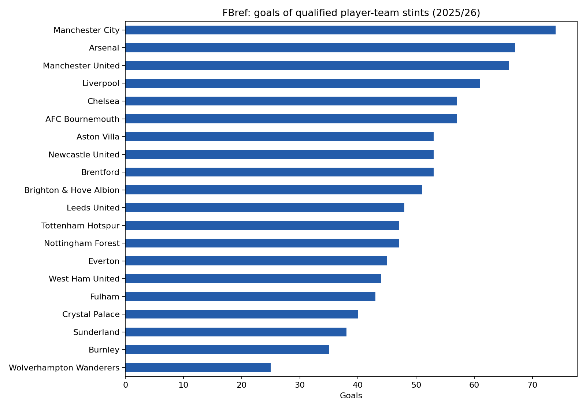
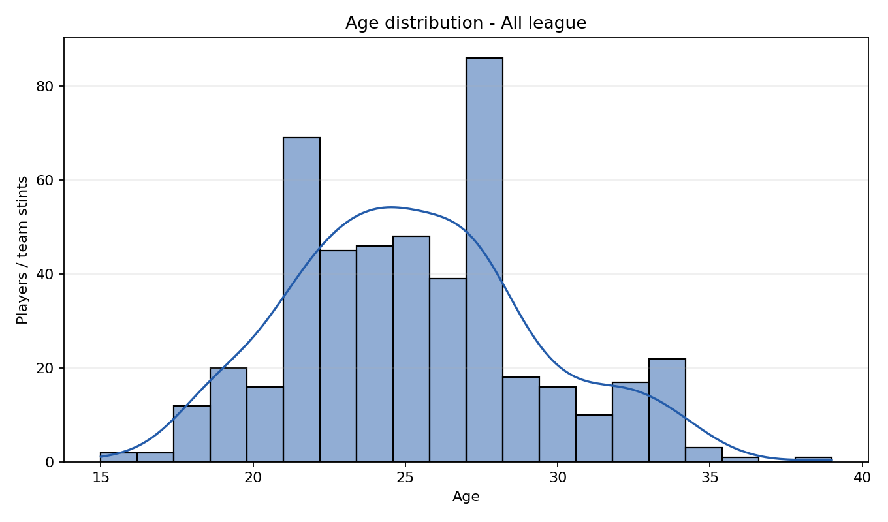
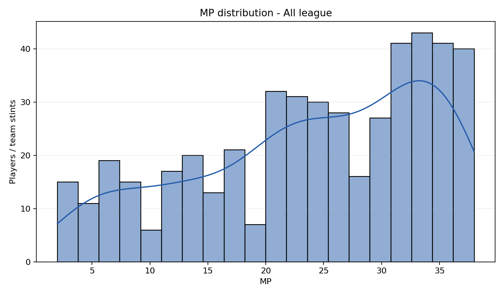
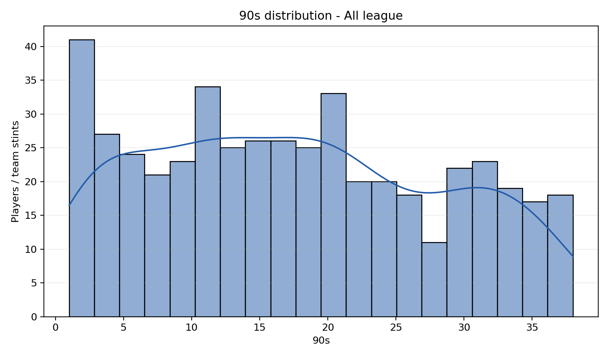
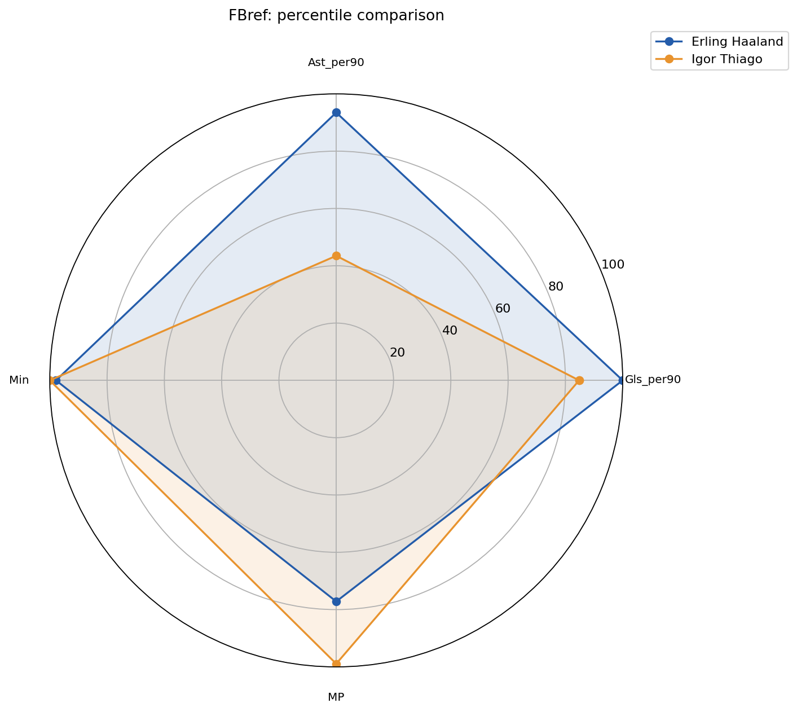
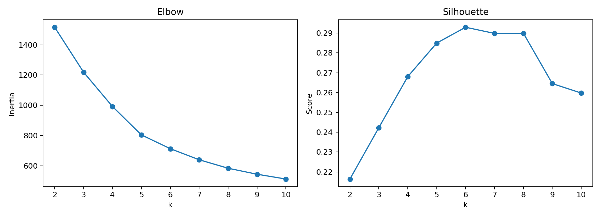
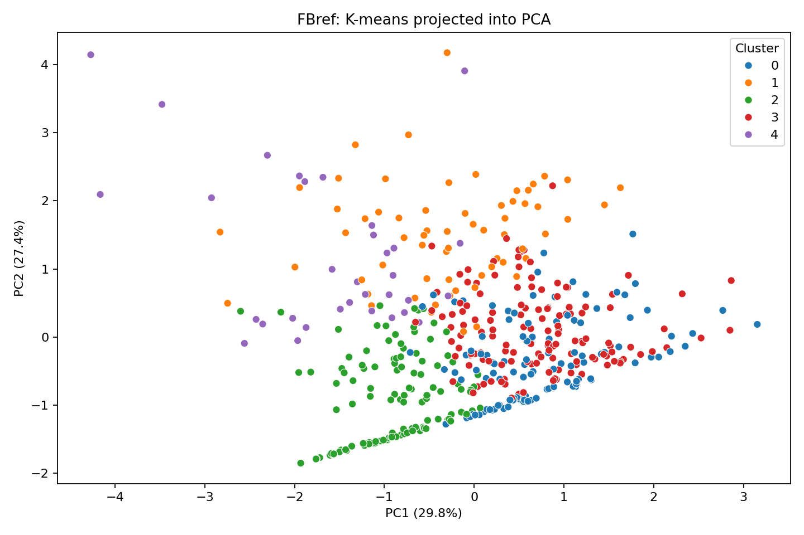
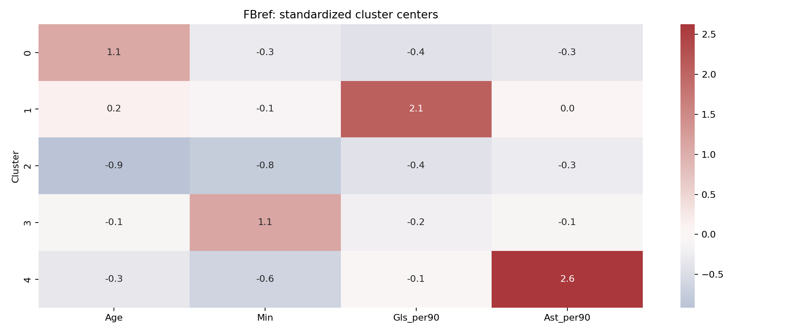
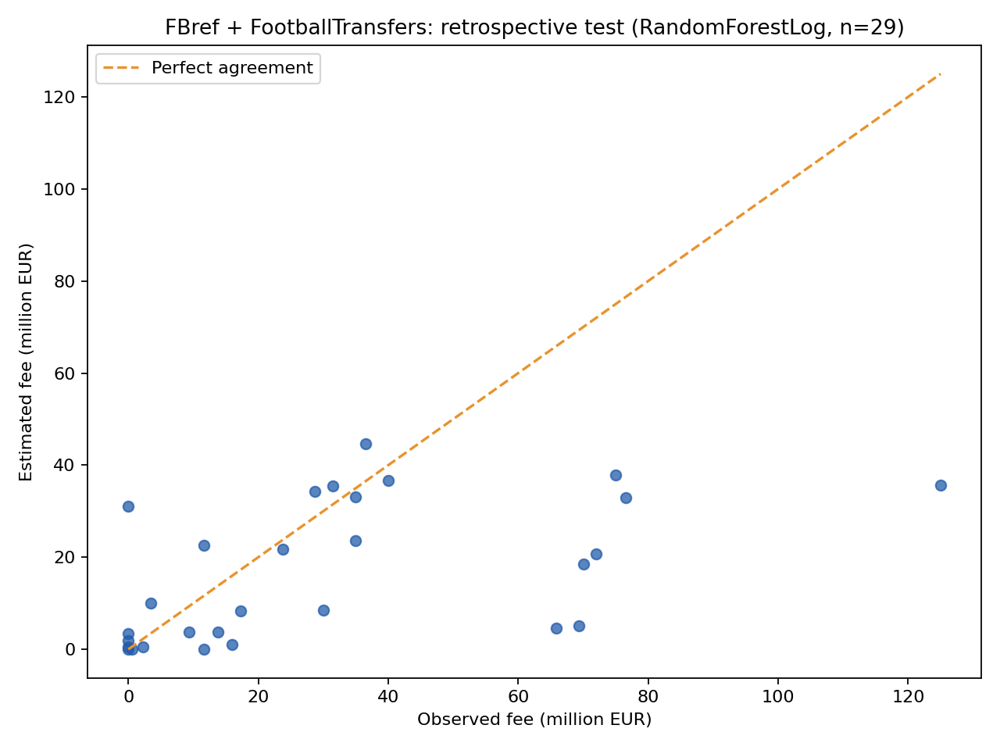

# PHÂN TÍCH CẦU THỦ PREMIER LEAGUE 2025-2026 TỪ FBREF GỐC

## 1. Nội dung, bài toán và yêu cầu

Phân tích thành tích cầu thủ/đội, thống kê phân phối, tìm nhóm cầu thủ tương đồng và khảo sát phí chuyển nhượng. Bài 1: tự thu thập HTML FBref, chuẩn hóa và lọc tổng phút >90. Bài 2: top/bottom 3, median/mean/std, histogram, đội dẫn đầu. Bài 3: K-means, PCA và radar. Bài 4: giao dịch trực tiếp FootballTransfers và minh họa mô hình phí nếu đủ dữ liệu thật.

Nguồn thống kê: FBref, mùa 2025-2026. Thu được 20/20 đội, 473 cầu thủ đủ điều kiện, 486 stint. Trạng thái: ĐỦ 20 ĐỘI.

Không tải FPL, không dùng CSV tổng hợp của bên thứ ba và không tạo dữ liệu thay cho phần thiếu. HTML do người dùng lưu vẫn là nội dung gốc FBref; phương thức thu thập được ghi ở cuối báo cáo.

Báo cáo chỉ trình bày những chỉ số có quan sát trong tập dữ liệu hiện tại. Dữ liệu chưa có không được tự điền 0. Tuổi dùng giá trị hiển thị trong bảng FBref.

## 2. Từ điển các chỉ số thực tế thu được

| Chỉ số | Ý nghĩa và lưu ý |
| --- | --- |
| PlayerID | Mã định danh từ nguồn; dùng ghép dữ liệu, không dùng làm đặc trưng thành tích. |
| Name / Nation / Position / Squad | Tên cầu thủ, quốc tịch, vị trí và đội; cầu thủ nhiều đội được ghép theo PlayerID. |
| Age | Tuổi hiển thị trong HTML FBref, không phải tuổi tự tính tại một ngày tham chiếu. |
| MP / Starts / Min | Số trận ra sân, số trận đá chính và tổng phút thi đấu. MP cộng theo cầu thủ là lượt ra sân, không phải số trận CLB. |
| 90s | Số trận 90 phút quy đổi = Min/90. |
| Gls / Ast / G+A | Bàn thắng, kiến tạo và tổng hai chỉ số theo FBref. |
| G-PK | Bàn thắng không tính bàn từ phạt đền. |
| PK / PKatt | Số bàn phạt đền và số lần thực hiện phạt đền. |
| CrdY / CrdR | Thẻ vàng và thẻ đỏ; giá trị cao không phải thành tích tốt. |
| Sh / SoT | Tổng cú sút và số cú sút trúng đích. |
| Saves | Số lần cứu thua của thủ môn; không có dữ liệu không được hiểu là 0. |
| CleanSheets | Số trận sạch lưới theo cầu thủ thủ môn; tổng theo nhóm cầu thủ không mặc nhiên là số trận sạch lưới chính thức của CLB. |
| *_per90 | Chỉ số tích lũy mỗi 90 phút = tổng chỉ số ×90/Min; ít phút làm tỷ lệ biến động lớn. Không cộng các tỷ lệ giữa các đội. |
| Median / Mean / Std | Trung vị, trung bình và độ lệch chuẩn mẫu ddof=1; Std có cùng đơn vị với chỉ số gốc. |

## 3. Thống kê và biểu đồ

Top/bottom lấy 3 dòng mỗi chỉ số, đồng hạng sắp tên rồi ID. Tổng mùa dùng PlayerID duy nhất; từng đội dùng stint để tránh gán toàn mùa cho đội cuối. Tỷ lệ và phần trăm không cộng giữa đội. Tổng bàn của nhóm cầu thủ được chọn không phải bảng bàn thắng chính thức CLB.

| Direction | Rank | Name | Squad | Value |
| --- | --- | --- | --- | --- |
| bottom | 1 | Aaron Hickey | Brentford | 0 |
| bottom | 2 | Aaron Ramsdale | Newcastle United | 0 |
| bottom | 3 | Aaron Wan-Bissaka | West Ham United | 0 |
| top | 1 | Erling Haaland | Manchester City | 27 |
| top | 2 | Igor Thiago | Brentford | 22 |
| top | 3 | Antoine Semenyo | AFC Bournemouth / Manchester City | 17 |

Mục đích: so sánh đóng góp ghi bàn giữa các đội. Trục dọc là đội, ngang là bàn; thanh dài hơn là nhiều bàn hơn. Chỉ cộng cầu thủ đủ điều kiện theo stint, không kể bàn phản lưới đối thủ.

## 3.1. Trả lời Bài 2: kết quả nổi bật

Bảng dưới trình bày ba cầu thủ đứng đầu về bàn thắng và kiến tạo. Toàn bộ top/bottom 3 cho mọi chỉ số có trong top3_bottom3.csv; kết quả theo toàn giải và 20 đội có trong results2.csv.

Số liệu này chỉ mô tả các HTML đã lưu, không tự xác nhận thời điểm cập nhật hoặc độ đầy đủ của từng trang trên website.

| Attribute | Rank | Name | Squad | Value |
| --- | --- | --- | --- | --- |
| Gls | 1 | Erling Haaland | Manchester City | 27 |
| Gls | 2 | Igor Thiago | Brentford | 22 |
| Gls | 3 | Antoine Semenyo | AFC Bournemouth / Manchester City | 17 |
| Ast | 1 | Bruno Fernandes | Manchester United | 21 |
| Ast | 2 | Rayan Cherki | Manchester City | 12 |
| Ast | 3 | Jarrod Bowen | West Ham United | 11 |

## 3.2. Thống kê toàn giải

| Attribute | median | mean | std |
| --- | --- | --- | --- |
| MP | 25 | 23.975 | 10.153 |
| Min | 1,535 | 1,583.482 | 958.1 |
| Gls | 1 | 2.123 | 3.341 |
| Ast | 1 | 1.454 | 1.99 |
| Age | 25 | 25.266 | 4.035 |
| Gls_per90 | 0.054 | 0.118 | 0.169 |
| Ast_per90 | 0.05 | 0.086 | 0.121 |

## 3.3. Đội dẫn đầu theo chỉ số

Giữ mọi đội đồng hạng. Age dùng tuổi trung bình; các chỉ số còn lại dùng tổng của cầu thủ đủ điều kiện. MP cộng theo cầu thủ là lượt ra sân, không phải số trận của CLB. Thẻ phạt cao không có nghĩa là thành tích tốt.

| Attribute | Aggregation | Squad | Value |
| --- | --- | --- | --- |
| Gls | Tổng | Manchester City | 74 |
| Ast | Tổng | Manchester City | 57 |
| CrdY | Tổng | Tottenham Hotspur | 101 |
| CrdR | Tổng | Chelsea | 8 |
| Saves | Tổng | Burnley | 137 |
| CleanSheets | Tổng | Arsenal | 19 |
| Sh | Tổng | Manchester City | 595 |
| SoT | Tổng | Manchester United | 214 |
| Age | Trung bình | Aston Villa | 27.28 |

## 4. Histogram và radar

Mục đích: quan sát cơ cấu và độ phân tán. Trục ngang là tuổi/số trận/90s; trục dọc là số cầu thủ trong mỗi khoảng (bin), không là tổng chỉ số. Đường KDE chỉ làm mượt phân phối, không là dự báo. 90s=Min/90, MP là số lần ra sân. Các hình đội dùng cùng cách đọc với cỡ mẫu stint của đội.

Mục đích: quan sát cơ cấu và độ phân tán. Trục ngang là tuổi/số trận/90s; trục dọc là số cầu thủ trong mỗi khoảng (bin), không là tổng chỉ số. Đường KDE chỉ làm mượt phân phối, không là dự báo. 90s=Min/90, MP là số lần ra sân. Các hình đội dùng cùng cách đọc với cỡ mẫu stint của đội.

Mục đích: quan sát cơ cấu và độ phân tán. Trục ngang là tuổi/số trận/90s; trục dọc là số cầu thủ trong mỗi khoảng (bin), không là tổng chỉ số. Đường KDE chỉ làm mượt phân phối, không là dự báo. 90s=Min/90, MP là số lần ra sân. Các hình đội dùng cùng cách đọc với cỡ mẫu stint của đội.

Mục đích: so sánh nhiều khía cạnh trên cùng thang 0-100. Tên cạnh các tia là chỉ số; mỗi màu là một cầu thủ trong chú giải. Bán kính là hạng trung bình chia cỡ nhóm tham chiếu ×100, không phải số bàn/phút gốc.

Điểm xa tâm là giá trị tương đối lớn hơn; không lấy diện tích đa giác làm điểm chất lượng. Thẻ phạt lớn không phải ưu điểm. File radar_values.csv chứa giá trị gốc, percentile và cỡ nhóm.

## 5. K-means, PCA và tâm cụm

Đặc trưng thực có: Age, Min, Gls_per90, Ast_per90. k=5; silhouette=0.2850; PCA 2D giữ 57.25% phương sai. Cột thiếu/không biến động bị loại trước khi chuẩn hóa.

| Cluster | Count | Age | Min | Gls_per90 | Ast_per90 |
| --- | --- | --- | --- | --- | --- |
| 0 | 116 | 29.69 | 1,294.207 | 0.049 | 0.044 |
| 1 | 63 | 25.873 | 1,497.714 | 0.47 | 0.088 |
| 2 | 122 | 21.582 | 852.598 | 0.048 | 0.052 |
| 3 | 139 | 24.849 | 2,647.065 | 0.081 | 0.074 |
| 4 | 33 | 23.939 | 986.182 | 0.109 | 0.402 |

Mục đích: đối chiếu số cụm k. Elbow có trục ngang k, dọc Inertia = tổng bình phương khoảng cách tới tâm cụm trên thang chuẩn hóa; tìm đoạn gãy, không chỉ chọn giá trị nhỏ nhất. Silhouette có thang [-1,1], gần 1 tách rõ, gần 0 sát ranh giới, âm có thể gán cụm chưa phù hợp; s=(b-a)/max(a,b).

Mỗi chấm là một cầu thủ; màu là mã K-means, không là thứ hạng. PC1/PC2 là tổ hợp tuyến tính các chỉ số chuẩn hóa; phần trăm cạnh trục là phương sai giữ lại. Chồng điểm có thể do mất thông tin khi chiếu, không chứng minh cầu thủ hoàn toàn giống nhau.

Hàng là cụm, cột là đặc trưng. Số trong ô là tâm trên thang z=(x-mean)/std do StandardScaler tính với ddof=0. Đỏ/dương cao hơn trung bình, xanh/âm thấp hơn; z=1 tương ứng một độ lệch chuẩn, không phải thêm một bàn. Đỏ không luôn tốt, cần đọc theo ý nghĩa chỉ số.

## 5.1. Trả lời Bài 3: diễn giải phân cụm

Cụm 0 có tuổi trung bình cao nhất: 29.690, gồm 116 cầu thủ.

Cụm 3 có thời gian thi đấu trung bình cao nhất: 2647.065, gồm 139 cầu thủ.

Cụm 1 có bàn/90 trung bình cao nhất: 0.470, gồm 63 cầu thủ.

Cụm 4 có kiến tạo/90 trung bình cao nhất: 0.402, gồm 33 cầu thủ.

Các mô tả dựa trên trung bình cụm, không gán nhãn vị trí hoặc chất lượng. Chỉ số mỗi 90 phút của cầu thủ ít phút dễ biến động; kết quả phụ thuộc tập đặc trưng còn lại trong nguồn.

## 5.2. So sánh hai cầu thủ bằng radar

So sánh Erling Haaland và Igor Thiago trong nhóm 46 cầu thủ cùng vị trí. Mỗi chỉ số có giá trị gốc và percentile dưới đây; percentile biểu thị giá trị tương đối, không phải xác suất thắng.

| Name | Attribute | RawValue | Percentile |
| --- | --- | --- | --- |
| Erling Haaland | Gls_per90 | 0.823 | 100 |
| Erling Haaland | Ast_per90 | 0.244 | 93.478 |
| Erling Haaland | Min | 2,953 | 97.826 |
| Erling Haaland | MP | 35 | 77.174 |
| Igor Thiago | Gls_per90 | 0.603 | 84.783 |
| Igor Thiago | Ast_per90 | 0.027 | 43.478 |
| Igor Thiago | Min | 3,282 | 100 |
| Igor Thiago | MP | 38 | 98.913 |

## 6. Chuyển nhượng và mô hình phí

FootballTransfers gốc: 312 giao dịch trong phạm vi; ghép được 113 theo tên duy nhất và đội. FeeEUR là phí EUR; miễn phí là 0, chưa biết là thiếu. Không dùng giá FPL.

Mô hình hồi cứu: RandomForestLog; train 84 giao dịch, test 29 giao dịch; tách theo cầu thủ, không tách theo thời gian. Đặc trưng đầu vào thực tế: Age, Min, Gls, Ast, MP. Đặc trưng cả mùa có thể xảy ra sau giao dịch. Mô hình chỉ khảo sát liên hệ hồi cứu, không được đánh giá như dự báo phí trước chuyển nhượng. Muốn dự báo cần cào thêm các mùa trước và khóa mốc thời gian.

MAE là trung bình trị tuyệt đối sai số phí; RMSE là căn trung bình sai số bình phương, phạt lỗi lớn mạnh hơn; cả hai tính EUR, thấp hơn là tốt hơn. R²=1-SSE/SST; âm nghĩa kém hơn mốc trung bình test theo sai số bình phương, không phải tỷ lệ dự đoán đúng.

Nếu chỉ có thành tích cả mùa 2025-2026 và phí giao dịch trong mùa, mô hình chỉ khảo sát liên hệ hồi cứu vì thành tích có thể xảy ra sau giao dịch. Muốn đánh giá dự báo trước giao dịch phải thu thêm mùa trước và khóa mốc thời gian; không được trình bày kết quả hồi cứu thành dự báo tương lai.

## 7. Trả lời Bài 4: kết quả kiểm định hồi cứu

Chọn RandomForestLog bằng MAE kiểm định chéo trên train. Test MAE=19.451 triệu EUR; RMSE=30.426 triệu EUR; R²=0.0469. Baseline median có MAE=24.310 triệu EUR.

Các cột MAE/RMSE trong bảng dùng triệu EUR. Sai số còn lớn; kết quả chỉ minh họa liên hệ giữa thành tích và phí trong dữ liệu đã ghép. Chưa đủ dữ liệu mùa trước để hoàn thành một bộ dự báo phí trước giao dịch có kiểm định theo thời gian.

| Model | TrainCV_MAE_million_EUR | Test_MAE_million_EUR | Test_RMSE_million_EUR | Test_R2 |
| --- | --- | --- | --- | --- |
| Median | 17.245 | 24.31 | 32.16 | -0.065 |
| RidgeLog | 27.796 | 54.563 | 164.82 | -26.967 |
| RandomForestLog | 13.765 | 19.451 | 30.426 | 0.047 |

Mỗi điểm là một giao dịch trong test; cả hai trục dùng triệu EUR. Đường chéo thể hiện ước lượng bằng phí thực tế; điểm dưới đường là ước lượng thấp, trên đường là cao. Đây là tập test tách theo cầu thủ, không phải dự báo giao dịch tương lai.

## 8. Nguồn gốc dữ liệu

Tạo lúc 2026-11-06T17:13:41+07:00. Các phân tích và mô hình chỉ sử dụng dữ liệu đã trích xuất thực tế. Giữ HTML gốc, data_quality.json và table_rows.csv để đối chiếu. Bảng trình bày 16 ký tự đầu SHA-256; hash đầy đủ nằm trong data_quality.json và run_manifest.json.

| URL | method | SHA256_prefix_16 |
| --- | --- | --- |
| https://fbref.com/en/squads/18bb7c10/2025-2026/Arsenal-Stats | browser-saved original FBref HTML | 3a15d1dc77596598 |
| https://fbref.com/en/squads/8602292d/2025-2026/Aston-Villa-Stats | browser-saved original FBref HTML | 7d25384f0188076f |
| https://fbref.com/en/squads/4ba7cbea/2025-2026/Bournemouth-Stats | browser-saved original FBref HTML | de3e2f83b2841841 |
| https://fbref.com/en/squads/cd051869/2025-2026/Brentford-Stats | browser-saved original FBref HTML | aff4d2326e105044 |
| https://fbref.com/en/squads/d07537b9/2025-2026/Brighton-and-Hove-Albion-Stats | browser-saved original FBref HTML | 3f99103189f7b2f4 |
| https://fbref.com/en/squads/943e8050/2025-2026/Burnley-Stats | browser-saved original FBref HTML | f8a034ea62163e83 |
| https://fbref.com/en/squads/cff3d9bb/2025-2026/Chelsea-Stats | browser-saved original FBref HTML | 2c2b2a7ce79827fe |
| https://fbref.com/en/squads/47c64c55/2025-2026/Crystal-Palace-Stats | browser-saved original FBref HTML | e60d2ceff125b941 |
| https://fbref.com/en/squads/d3fd31cc/2025-2026/Everton-Stats | browser-saved original FBref HTML | 68bd06eba85c4643 |
| https://fbref.com/en/squads/fd962109/2025-2026/Fulham-Stats | browser-saved original FBref HTML | 85faf1d7ff9937e1 |
| https://fbref.com/en/squads/5bfb9659/2025-2026/Leeds-United-Stats | browser-saved original FBref HTML | 499f593346085e53 |
| https://fbref.com/en/squads/822bd0ba/2025-2026/Liverpool-Stats | browser-saved original FBref HTML | c1909d85d5d25628 |
| https://fbref.com/en/squads/b8fd03ef/2025-2026/Manchester-City-Stats | browser-saved original FBref HTML | 13f23228cec7fb42 |
| https://fbref.com/en/squads/19538871/2025-2026/Manchester-United-Stats | browser-saved original FBref HTML | 0698698da41357e9 |
| https://fbref.com/en/squads/b2b47a98/2025-2026/Newcastle-United-Stats | browser-saved original FBref HTML | 8163fc18632360c8 |
| https://fbref.com/en/squads/e4a775cb/2025-2026/Nottingham-Forest-Stats | browser-saved original FBref HTML | 8880c7d8ae0aa7a7 |
| https://fbref.com/en/squads/8ef52968/2025-2026/Sunderland-Stats | browser-saved original FBref HTML | e7a391b36e4313b1 |
| https://fbref.com/en/squads/361ca564/2025-2026/Tottenham-Hotspur-Stats | browser-saved original FBref HTML | 38d40a45fb87457e |
| https://fbref.com/en/squads/7c21e445/2025-2026/West-Ham-United-Stats | browser-saved original FBref HTML | 67cbeb34b292d2ea |
| https://fbref.com/en/squads/8cec06e1/2025-2026/Wolverhampton-Wanderers-Stats | browser-saved original FBref HTML | a0f6c502d14a80e0 |

## 9. Các bảng thực tế đã trích xuất theo đội

Số hồ sơ trong bảng là số dòng cầu thủ ở bảng standard trước khi lọc tổng phút >90; có thể gồm cầu thủ chưa thi đấu và cùng cầu thủ đăng ký ở nhiều đội.

| Squad | ExtractedTables | PlayerRowsBeforeFilter |
| --- | --- | --- |
| Arsenal | standard, keeper, shooting, playing_time, misc | 29 |
| Aston Villa | standard, keeper, shooting, playing_time, misc | 39 |
| AFC Bournemouth | standard, keeper, shooting, playing_time, misc | 36 |
| Brentford | standard, keeper, shooting, playing_time, misc | 36 |
| Brighton & Hove Albion | standard, keeper, shooting, playing_time, misc | 32 |
| Burnley | standard, keeper, shooting, playing_time, misc | 34 |
| Chelsea | standard, keeper, shooting, playing_time, misc | 36 |
| Crystal Palace | standard, keeper, shooting, playing_time, misc | 37 |
| Everton | standard, keeper, shooting, playing_time, misc | 32 |
| Fulham | standard, keeper, shooting, playing_time, misc | 29 |
| Leeds United | standard, keeper, shooting, playing_time, misc | 31 |
| Liverpool | standard, keeper, shooting, playing_time, misc | 33 |
| Manchester City | standard, keeper, shooting, playing_time, misc | 36 |
| Manchester United | standard, keeper, shooting, playing_time, misc | 34 |
| Newcastle United | standard, keeper, shooting, playing_time, misc | 30 |
| Nottingham Forest | standard, keeper, shooting, playing_time, misc | 36 |
| Sunderland | standard, keeper, shooting, playing_time, misc | 38 |
| Tottenham Hotspur | standard, keeper, shooting, playing_time, misc | 39 |
| West Ham United | standard, keeper, shooting, playing_time, misc | 37 |
| Wolverhampton Wanderers | standard, keeper, shooting, playing_time, misc | 39 |
